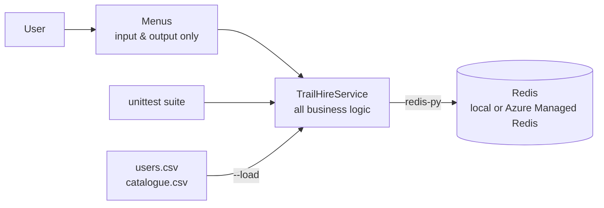

# TrailHire: Outdoor Equipment Rental App (Redis + Python)

A command-line rental app for an outdoor equipment business. It uses **Redis** as a key-value database. Customers can create an account, log in, recover a forgotten password, browse the equipment catalogue and manage a rental list, and stock levels update live as items are added and removed.


## Features

**Core**
- **Create account:** collects the user's details and assigns a **random security question** from a Redis set
- **Login:** checks the email and password; email matching ignores case
- **Forgot password:** answer the assigned security question to set a new password
- **Rental list:** add, view and remove equipment, with a daily cost total
- **CSV data loader:** loads sample users, their rental lists and the catalogue for testing

**Advanced**
- **Password hashing:** PBKDF2-HMAC-SHA256 with a random per-user salt and 100,000 iterations. Security answers are hashed too, and hashes are compared in constant time
- **Activity logging:** logins, failed logins, password resets and rental changes are stored in capped Redis lists, both per user and globally
- **Catalogue and inventory:** equipment has daily rates and stock levels; renting an item reduces stock and removing it restores stock
- **No overselling:** stock is reserved with atomic `HINCRBY`, so two customers can't both rent the last item
- **Automated tests:** 21 `unittest` cases run in an isolated namespace, or fully in memory with `fakeredis`

## Redis key design

All keys share the `trailhire:` namespace.

| Key | Type | Contents |
|-----|------|----------|
| `trailhire:security_questions` | SET | All security questions. `SRANDMEMBER` picks one at random |
| `trailhire:users` | SET | Every registered email |
| `trailhire:user:<email>` | HASH | email, first_name, password *(hash)*, security_question, security_answer *(hash)*, created_at |
| `trailhire:rentals:<email>` | HASH | equipment ID → quantity |
| `trailhire:catalogue` | SET | All equipment IDs |
| `trailhire:equipment:<id>` | HASH | name, category, daily_rate, total_quantity, available |
| `trailhire:log:user:<email>` | LIST | Newest-first activity for one user (capped at 200) |
| `trailhire:log:all` | LIST | Newest-first activity for everyone (capped at 1,000) |

**Why this design?**
- **Hashes** suit records with named fields: one `HGETALL` reads a whole account, and `HSET` updates a single field such as the password.
- A **hash for the rental list** stores quantities and makes duplicate items impossible. `HINCRBY` changes quantities atomically.
- A **set for security questions** keeps them unique and gives random selection for free.
- **`HSETNX`** on account creation means two people registering the same email at the same moment can't overwrite each other.
- **`LPUSH` + `LTRIM`** keep logs newest-first with bounded memory, and failed logins for unknown emails can't create unlimited keys.
- **Pipelines** batch multi-key reads into one round trip, which keeps the app quick against a cloud-hosted, clustered Redis.

More detail and pseudocode for each process are in [`docs/design.md`](docs/design.md).

## Architecture



The menus only collect input and print results, and all database access lives in `TrailHireService`. That separation keeps the logic easy to unit test and means a web front end could reuse it unchanged.

## Getting started

**Requirements:** Python 3.8+ and a Redis server.

```bash
pip install -r requirements.txt

# Start a local Redis (or use any hosted Redis; see Configuration)
docker run -d -p 6379:6379 redis

python trailhire.py --load    # reset TrailHire data and load the sample CSVs
python trailhire.py           # run the app
python trailhire.py --test    # run the automated tests (saves test_results.txt)
```

Once the sample data is loaded, you can log in with `alice@example.com` / `Alice#2026`. These are test accounts from [`users.csv`](users.csv).

### Example: the equipment catalogue

```
ID         Name                          Category     $/day  Avail
------------------------------------------------------------------
COOK-SET   Camp Cookware Set             Cooking       7.00     10
STOVE-GAS  Portable Gas Stove            Cooking      10.00      9
LAMP-LED   Rechargeable LED Lantern      Lighting      5.00     20
PACK-45    45L Hiking Backpack           Packs        15.00     10
PACK-65    65L Trekking Backpack         Packs        20.00      6
TENT-2P    2-Person Dome Tent            Shelter      25.00      8
TENT-4P    4-Person Family Tent          Shelter      40.00      5
MAT-INF    Inflatable Sleeping Mat       Sleeping      8.00     15
BAG-SUM    Summer Sleeping Bag (+10C)    Sleeping     12.00     12
BAG-WIN    Winter Sleeping Bag (-5C)     Sleeping     18.00      6
KAYAK-1    Single Sea Kayak              Water        65.00      3
SUP-BOARD  Stand-Up Paddleboard          Water        55.00      4
```

### Configuration

Connection settings come from environment variables. The defaults connect to a local Redis on `localhost:6379`.

| Variable | Default | Example for Azure Managed Redis |
|----------|---------|---------------------------------|
| `TRAILHIRE_REDIS_HOST` | `localhost` | `<name>.australiaeast.redis.azure.net` |
| `TRAILHIRE_REDIS_PORT` | `6379` | `10000` |
| `TRAILHIRE_REDIS_PASSWORD` | *(empty)* | your access key |
| `TRAILHIRE_REDIS_SSL` | `false` | `true` |
| `TRAILHIRE_REDIS_CLUSTER` | `false` | `true` |

The project was deployed on **Azure Managed Redis** (Australia East), which requires TLS and uses a clustered layout. The app uses redis-py's cluster-aware client and remaps shard addresses back to the hostname, so TLS certificate checks still pass.

## Testing

`python trailhire.py --test` runs 21 unit tests. Each test starts with a clean `trailhire_test:` namespace and removes its keys afterwards, so the tests never touch live data. If `fakeredis` is installed, the tests run entirely in memory.

| Area | What's tested |
|------|---------------|
| Database design | Questions stored in a set; each account gets a random question from it |
| Security | Passwords and answers stored only as hashes; salting gives different hashes for the same password |
| Create account | Duplicate emails rejected (ignoring case); invalid email, short password and blank name rejected |
| Login | Correct details work; email case is ignored; wrong password and unknown account fail |
| Forgot password | Wrong answer fails and the old password still works; correct answer resets it; short new password rejected |
| Rentals & inventory | Adding reduces stock; can't rent more than is available; unknown items and zero quantity rejected; totals correct; partial and full removal restock |
| Logging | Login attempts and rental changes are logged in order |
| CSV loader | Creates users, rentals and stock; reloading skips existing users without double-counting stock |

All 21 tests passed against the live Azure Managed Redis database, and every menu option was also tested by hand.

## Challenges & what I learned

Deploying to **Azure Managed Redis** caused two real problems that local testing never showed:

1. **"Redis Cluster cannot be connected."** The loader crashed straight away. A plain connection test returned `True`, which proved the key, network and TLS were all fine, so the problem had to be in the cluster client. Switching to a standard (non-cluster) connection made the loader and all 21 tests pass.
2. **`MovedError` when creating an account.** Manual testing then crashed with `MOVED 5914 <ip>:8500`. Azure splits the data across shards. The standard connection reached only one shard, and the test keys had happened to hash to that shard while my account key landed on another. The real root cause of the first error turned out to be this: Azure hands out each shard's **IP address**, but its TLS certificate only matches the **hostname**, so the cluster client's secure connections were rejected.

**The fix:** go back to the cluster-aware client and add an `address_remap` that keeps each shard's port but swaps the IP for the hostname. Every connection is still TLS-verified and reaches the right shard.

**What I learned:** passing automated tests isn't enough when the environment differs. The tests passed by luck of key placement, and it was manual end-to-end testing that found the real bug.

## Future improvements

- A Flask web interface that reuses `TrailHireService`, with sessions stored in Redis
- Rental bookings with start and end dates, so stock is reserved only for those dates
- Stock check and rental update in a single Lua script or `MULTI`/`EXEC` transaction
- Account lockout after repeated failed logins (`INCR` + `EXPIRE`)
- bcrypt or Argon2 hashing, and Microsoft Entra ID authentication to Azure instead of an access key
- Redis Streams for searchable activity logs

## Project structure

```
├── trailhire.py      # The whole app: data layer, CLI menus and unit tests
├── users.csv         # Sample accounts and rental lists (test data only)
├── catalogue.csv     # Sample equipment catalogue
├── requirements.txt
└── docs/design.md    # Key design, rationale and pseudocode
```

## Context

Built for a database programming assessment in my Bachelor of Information Technology at the University of the Sunshine Coast (UniSC). The brief asked for a key-value database in Redis with a Python application layer for a fictional rental company.

## License

[MIT](LICENSE)
